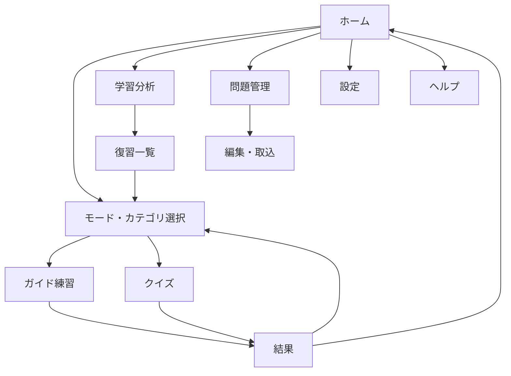

# 画面一覧・遷移・ワイヤーフレーム

## 画面
ホーム、モード/カテゴリ選択、ガイド練習、クイズ、4択/自己申告、結果、学習分析、復習一覧、問題管理（一覧/編集/インポート）、設定、ヘルプ。

## 遷移


## PCワイヤーフレーム
```
+--------------------------------------------------------------+
| Shortcut Trainer | ホーム 練習 分析 問題管理 設定 | XP/レベル |
+--------------------------------------------------------------+
| カテゴリ Excel / 難易度 初級 / 3 of 10   [進捗バー]          |
|                                                              |
|          次の操作: セルを編集する                              |
|          [ガイド時のみ: F2]                                   |
|          [キー入力状態 / 正誤 / 代替採点への切替]               |
|                                                              |
| [キーボード図: JIS/US切替、正解キー・押下キーのハイライト]     |
|                                                              |
| [一時停止] [問題をスキップ] [終了]                             |
+--------------------------------------------------------------+
```

## スマホワイヤーフレーム
```
+--------------------------+
| Shortcut Trainer  [設定] |
| Excel 初級    3/10       |
| セルを編集する           |
| [選択肢A]               |
| [選択肢B]               |
| [選択肢C]               |
| [選択肢D]               |
| [次へ]                   |
+--------------------------+
```

## 主要UI規則
- ガイドは正解キーを表示し、クイズは回答前に隠す。結果は正誤、正解、説明、採点方法を表示。
- フォーカス可能な「回答開始/停止」操作を設け、ショートカット入力とナビゲーションを分離。
- 正誤は色以外の文字/アイコンで表示。読み上げ通知は過剰に連発させない。
- 画面幅に応じてナビゲーション・グラフ・キーボードを再配置。スマホは物理キー入力を必須としない。
- 分析画面はカテゴリ別進捗、日次推移、弱点、期限到来の復習、回答速度を表示。異なる採点方式の数値は区別する。
